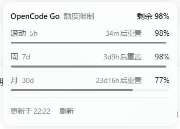

# dsh-meter · 额度仪表

> 在 DeepSeek Harness 输入框下方加一个和上下文圆环同款的小圆环，实时显示当前模型套餐还剩多少额度；点开能看到每一档额度的重置时间。

[](./LICENSE)
[](https://github.com/deepseek-ai/deepseek-harness)

<br>

```
                    22.4K tok · 缓存命中 5%      ◔ 34%      ◔ 99%
                                                  ↑上下文     ↑额度
```

<br>



---

## 为什么

订阅了 coding plan 之后，最常问自己的两句话是「现在还能不能干活」和「什么时候恢复」。这些数字都在各家控制台里，切一次窗口就打断一次心流。

`dsh-meter` 把它挪到输入框下面，和 DSH 自带的上下文占用环并排：

- **收起态**只占一个 14px 圆环 + 百分比，不抢位置
- **展开态**列出每一档额度（滚动 / 周 / 月 / 年）、各自的百分比和重置时间
- 颜色跟随 DSH 主题 token，深浅色主题都自适应

## 支持

| 供应商 | 额度来源 | 需要绑定 |
|---|---|---|
| **MiniMax** | `token_plan/remains` | 否，复用已有 API Key |
| **Kimi** | `coding/v1/usages` | 否，复用已有 API Key |
| **OpenCode Go** | `zen/go/v1/usage` | 否，复用已有 API Key |
| **StepFun** | 控制台 `QueryStepPlanRateLimit` | 是，浏览器登录一次 |
| **小米 MiMo** | 控制台 `tokenPlan/usage` | 是，浏览器登录一次 |

小米的几个通道都能识别：`xiaomi`、`xiaomi-token-plan-cn`、`xiaomi-token-plan-ams`、`xiaomi-token-plan-sgp`、以及走 OpenCode Go 转发但模型名是 `mimo-*` 的情况。

## 安装

### 从 GitHub 安装

```powershell
dsh plugin --profile desktop add "github:xiufeigo/dsh-meter"
```

装完把 `dsh-meter` 加进 `%USERPROFILE%\.dsh\profiles\desktop\package.json` 的 `dsh.profile.bundles` 数组，然后**完全退出 DSH 再打开**。

### 从本地目录 / 压缩包安装（推荐给不熟悉命令行的朋友）

1. 下载本仓库（`Code → Download ZIP`）或 `npm pack` 出来的 `.tgz`
2. DSH → **设置** → **内置插件** → **添加插件**
3. 粘贴**本地目录路径**或**`.tgz` 路径**，例如：

   ```
   C:\dsh-plugins\dsh-meter
   C:\dsh-plugins\dsh-meter-1.0.0.tgz
   ```

4. 安装 → **完全退出 DSH 再重新打开**（刷新页面不行，插件是启动时装载的）

> DSH 的「添加插件」支持四种来源：npm 包名、Git 仓库地址、本地目录、压缩包。

### 卸载

设置 → 内置插件 → 找到「额度仪表」→ 卸载 → 重启。

## 使用

### API Key 类：开箱即用

MiniMax / Kimi / OpenCode Go 直接复用「设置 → 模型」里已经配好的 API Key，装完就能看到数字。

### 控制台类：登录一次

**StepFun** 和 **小米 MiMo** 的套餐额度只在控制台里，需要绑一次登录态：

1. 切到对应模型，圆环会变成 `🔒 绑定`，点它
   （也可以走 设置 → 内置插件 → 额度仪表）
2. 点「**浏览器登录并自动绑定**」
3. 会弹出你电脑的**默认浏览器**（Windows 上是 Edge）并打开控制台登录页
4. 在里面正常登录 → 插件自动读取 Cookie、校验、绑定，**不需要手动复制任何东西**

绑定成功后浏览器配置会留在 `%USERPROFILE%\.dsh\dsh-meter\browser-profiles\`，以后再失效通常**不弹窗**就能静默续上。

不想用浏览器？绑定弹窗里还有「或者手动粘贴 Cookie · 展开」的兜底路径。

## 显示规则

| 情况 | 表现 |
|---|---|
| 只有一档额度 | 圆环 + 百分比；点开显示重置**日期**，不重复画行 |
| 多档额度 | 圆环显示**刷新周期最短**那档（有滚动就显示滚动） |
| 重置在 24 小时内 | `34m后重置` |
| 重置超过 24 小时 | `重置 11-09 08:00` |
| 剩余 ≤ 30% | 琥珀色 |
| 剩余 ≤ 10% | 红色 |

## 工作原理

```
┌──────────────── DSH Host 进程 ────────────────┐        ┌──── 浏览器 ────┐
│  index.js                                     │        │                │
│   ├─ /plugins/dsh-meter/quota   额度查询       │        │  控制台登录页   │
│   ├─ /plugins/dsh-meter/login   拉起浏览器     │◀──CDP──│  (Edge/Chrome) │
│   ├─ /plugins/dsh-meter/setup   手动 Cookie    │  管道  │                │
│   └─ /plugins/dsh-meter/status  诊断           │        └────────────────┘
└───────────────────────▲───────────────────────┘
                        │ same-origin fetch
┌───────────────────────┴───────────────────────┐
│  client.js（浏览器侧）                          │
│   ├─ conversation.composer.dock  圆环          │
│   └─ settings.plugins.tab        设置页        │
└───────────────────────────────────────────────┘
```

几点实现上的取舍：

- **控制台登录**用 `--remote-debugging-pipe` 起一个自己控制的 Chromium，通过 DevTools 协议
  （NUL 分隔的 JSON-RPC，走 fd 3/4）读它的 Cookie 罐。不占端口、不需要 Playwright/Puppeteer 之类的依赖。
- **StepFun 的 token 很短命**，所以绑定成功后会在后台留一个无头浏览器停在控制台页面，让页面自己的前端去续期，
  每 2 分钟同步一次 Cookie；查询遇到 401 会先自动重试一次，连续失败 3 次就自动关掉。
- **徽章位置**在 `conversation.composer.dock` 插槽里。DSH 的 dock 先渲染插槽再渲染上下文环，
  所以用 flex `order` 把自己的节点推到最后一个，落在上下文环右边。
- 界面侧只用 `react` / `react-dom`（DSH 的 module seed），**零第三方依赖、无构建步骤**。

## 开发

```bash
git clone https://github.com/xiufeigo/dsh-meter.git
cd dsh-meter
npm test          # 用假 React 渲染客户端两种状态，校验文案和 DOM 结构
npm run pack:release
```

改完代码后重新安装一次即可（DSH 的插件是启动时装载的）：

```powershell
dsh plugin --profile desktop add "C:\path\to\dsh-meter"
```

调试路由（只在本地 `127.0.0.1` 上可访问）：

| 路由 | 用途 |
|---|---|
| `GET /plugins/dsh-meter/status` | 客户端是否装载、provider 路由、凭据状态、客户端日志 |
| `GET /plugins/dsh-meter/raw?family=...` | 各套餐的原始用量响应（不含密钥） |
| `GET /plugins/dsh-meter/hmr` | 让客户端模块重新装载，免刷新 |
| `GET /plugins/dsh-meter/keepalive?family=...` | 手动启停后台保活浏览器 |

## 已知限制

- 依赖 DSH 的 `conversation.composer.dock` 与 `settings.plugins.tab` 两个 UI 插槽，随 DSH 版本变化；DSH < 0.2.2-rc.1 可能没有
- 控制台登录需要 Chromium 系浏览器（Chrome / Edge / Brave / Vivaldi / Opera），Firefox 不支持 `--remote-debugging-pipe`
- 控制台接口一旦改版，对应的解析要跟着改
- 插件只把百分比、重置时间和套餐名回传给界面，**不显示也不外传任何密钥或 Cookie 内容**

## License

[MIT](./LICENSE)
